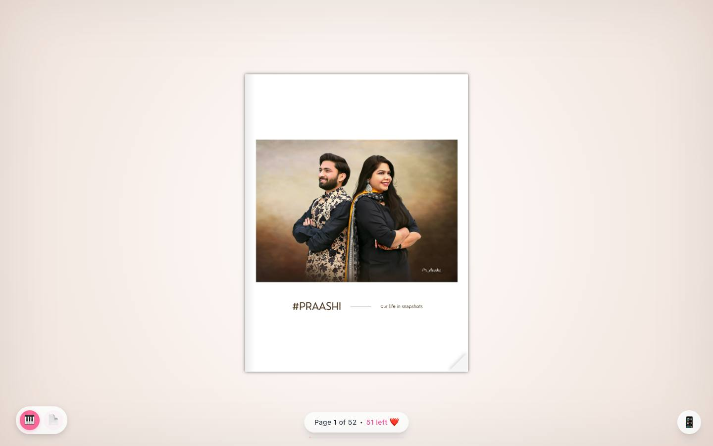
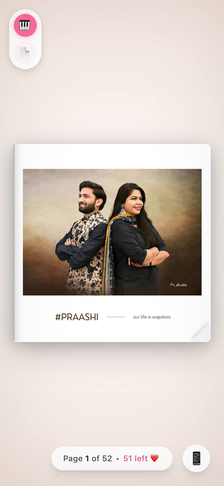

# 📖 Flipbook Web App

> A mobile-friendly photo flipbook with page-turn animation and music.

**Live:** [praashi-lovebook.web.app](https://praashi-lovebook.web.app/)

<p align="center">
  
  
</p>


A beautiful, mobile-friendly flipbook application built with React, Tailwind CSS, and StPageFlip.

## ✨ Features

- 📱 Fully responsive and mobile-optimized
- 🎨 Smooth page-flip animations with realistic curl effect
- 👆 Touch/swipe support for mobile devices
- 🖼️ Image preloading with loading screen
- 🎵 Optional background music support
- 🎥 Optional video embedding on last page
- 🔥 Firebase Hosting ready
- 🎯 Clean, minimal aesthetic with beige background (#f4f1ec)

## 🚀 Quick Start

### 1. Install Dependencies

```bash
npm install
```

### 2. Add Your Images

Place your PNG images in the `public/pages/` folder, named as:
- `1.png`
- `2.png`
- `3.png`
- ... up to `52.png` (or however many you have)

**Important:** Update the `PAGE_COUNT` variable in `src/components/FlipBook.jsx` to match your total number of pages.

```javascript
const PAGE_COUNT = 52; // Change this to your page count
```

### 3. Development Mode

```bash
npm run dev
```

Open [http://localhost:5173](http://localhost:5173) in your browser.

### 4. Build for Production

```bash
npm run build
```

This creates an optimized build in the `dist/` folder.

### 5. Preview Production Build

```bash
npm run preview
```

## 📁 Project Structure

```
flipbook/
├── public/
│   └── pages/
│       ├── 1.png
│       ├── 2.png
│       └── ... (52.png)
├── src/
│   ├── components/
│   │   └── FlipBook.jsx
│   ├── App.jsx
│   ├── main.jsx
│   └── index.css
├── index.html
├── package.json
├── vite.config.js
├── tailwind.config.js
├── postcss.config.js
├── firebase.json
└── README.md
```

## 🔧 Configuration

### Changing Page Count

Edit `src/components/FlipBook.jsx`:

```javascript
const PAGE_COUNT = 52; // Your number of pages
```

### FlipBook Settings

The PageFlip configuration in `FlipBook.jsx` can be customized:

```javascript
const pageFlip = new PageFlip(bookRef.current, {
  width: 550,           // Base width
  height: 733,          // Base height
  size: 'stretch',      // Responsive mode
  minWidth: 320,        // Min mobile width
  maxWidth: 900,        // Max desktop width
  minHeight: 450,       // Min height
  maxHeight: 700,       // Max height
  showCover: true,      // Show as book cover
  mobileScrollSupport: false,
  swipeDistance: 30,    // Swipe sensitivity
  flippingTime: 1000,   // Animation duration (ms)
});
```

### Background Color

Change in `tailwind.config.js`:

```javascript
colors: {
  'book-bg': '#f4f1ec', // Your color
},
```

## 🎵 Optional Features

### Background Music

Uncomment in `src/App.jsx`:

```javascript
<audio autoPlay loop>
  <source src="/music.mp3" type="audio/mpeg" />
</audio>
```

Then add `music.mp3` to your `public/` folder.

### Video on Last Page

In `src/components/FlipBook.jsx`, change `false` to `true`:

```javascript
{pageNum === PAGE_COUNT && true && (
  <div className="absolute inset-0 flex items-center justify-center bg-white">
    <video controls autoPlay loop muted playsInline className="max-w-full max-h-full">
      <source src="/video.mp4" type="video/mp4" />
    </video>
  </div>
)}
```

Then add `video.mp4` to your `public/` folder.

## 🔥 Firebase Deployment

### First-Time Setup

1. Install Firebase CLI:
```bash
npm install -g firebase-tools
```

2. Login to Firebase:
```bash
firebase login
```

3. Initialize Firebase (if not already done):
```bash
firebase init hosting
```

Select:
- Use an existing project or create a new one
- Public directory: `dist`
- Configure as SPA: `Yes`
- Set up automatic builds: `No`

4. Update `.firebaserc` with your project ID:
```json
{
  "projects": {
    "default": "your-firebase-project-id"
  }
}
```

### Deploy Steps

1. Build the project:
```bash
npm run build
```

2. Deploy to Firebase:
```bash
firebase deploy
```

3. Your app will be live at: `https://your-project-id.web.app`

### Quick Deploy Script

Add to `package.json` scripts:

```json
"scripts": {
  "deploy": "npm run build && firebase deploy"
}
```

Then run:
```bash
npm run deploy
```

## 📱 Mobile Optimization

The app includes:
- ✅ Responsive viewport meta tag
- ✅ Touch gesture support
- ✅ Disabled overscroll/bounce
- ✅ Stretch sizing for various screen sizes
- ✅ Fixed body positioning to prevent scroll
- ✅ Optimized image loading

## 🎨 Customization

### Colors

Edit `tailwind.config.js` to add custom colors:

```javascript
theme: {
  extend: {
    colors: {
      'book-bg': '#f4f1ec',
      'custom-color': '#yourcolor',
    },
  },
},
```

### Fonts

Add Google Fonts to `index.html`:

```html
<link href="https://fonts.googleapis.com/css2?family=Your+Font&display=swap" rel="stylesheet">
```

Update `src/index.css`:

```css
body {
  font-family: 'Your Font', sans-serif;
}
```

## 🐛 Troubleshooting

### Images not loading
- Ensure images are in `public/pages/` folder
- Check naming: `1.png`, `2.png`, etc. (not `page-1.png`)
- Verify `PAGE_COUNT` matches your actual page count

### Flipbook not rendering
- Check browser console for errors
- Ensure all dependencies are installed
- Clear cache and rebuild: `rm -rf node_modules dist && npm install && npm run build`

### Mobile scrolling issues
- Verify `mobileScrollSupport: false` in PageFlip config
- Check `overflow: hidden` is applied to body in `index.css`

### Firebase deployment fails
- Ensure you've run `npm run build` first
- Verify `.firebaserc` has correct project ID
- Check Firebase CLI is logged in: `firebase login`

## 📚 Tech Stack

- **React 18** - UI framework
- **Vite 5** - Build tool
- **Tailwind CSS 3** - Styling
- **page-flip (StPageFlip) 2.0** - Flipbook library
- **Firebase Hosting** - Deployment

## 📄 License

MIT License - feel free to use for personal or commercial projects.

## 💡 Tips

1. **Image Optimization**: Compress your PNG images before adding them to reduce load time
2. **Performance**: The app preloads all images - consider lazy loading for 100+ pages
3. **Testing**: Test on actual mobile devices, not just browser dev tools
4. **Aspect Ratio**: Keep all images at the same aspect ratio for best results
5. **File Size**: Keep individual images under 500KB for optimal performance

## 🤝 Support

For issues or questions:
1. Check the troubleshooting section above
2. Review the [page-flip documentation](https://github.com/Nodlik/StPageFlip)
3. Check browser console for error messages

---

Made with ❤️ for preserving beautiful memories
